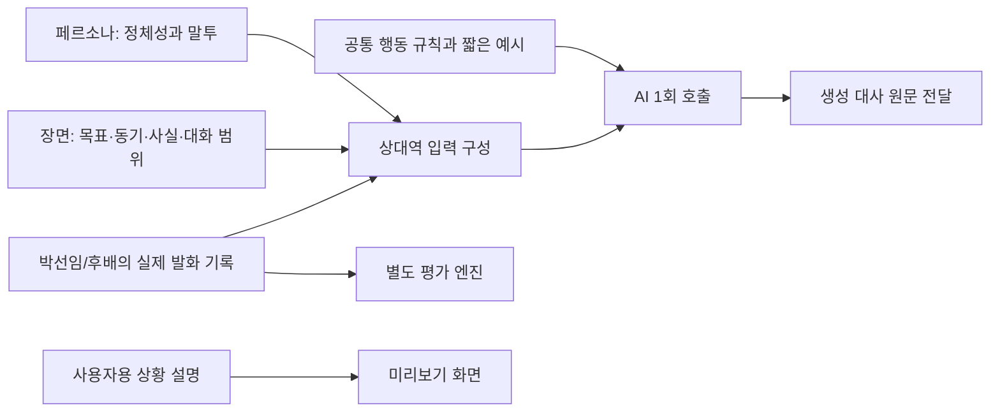

# 미러팅 역할극 프롬프트 구조와 수정 가이드

검토일: 2026-10-14. 대상: 전시용 직장 시나리오 4개, 한 장면에서 사용자 답변 5회.

## 1. 공개된 유사 서비스 설계에서 참고한 내용

다른 서비스의 비공개 운영 프롬프트를 확인한 것은 아니다. 아래는 공식 문서에 공개된 기능과 설계 설명이며, 현재 구현은 이를 참고해 우리 서비스 규모에 맞춘 것이다.

| 자료 | 확인한 내용 | 이번 적용 |
|---|---|---|
| [Convai Narrative Design](https://convai.com/blog/convai-narrative-design) | 장면의 현재 목표를 캐릭터 배경·지식·성격·기억과 함께 매 턴 전달한다. | 최초 목표를 매 호출에 명시하고, 대사 대신 목표 중심으로 생성한다. |
| [Charisma Improvisation](https://docs.charisma.ai/improvisation) | 대화 동기·관심 주제·성격·배경 사실을 biography에 넣고, 짧은 예시 대화와 memory를 활용한다. | 목표와 동기를 구분하고 사실·말투·짧은 행동 예시를 분리한다. |
| [Google Prompt design](https://ai.google.dev/gemini-api/docs/prompting-strategies) | 명확한 역할, 일관된 구획, 필요한 맥락, 구체적인 소수 예시를 권장한다. | Markdown 구획과 화자별 JSON 기록을 쓰며, 모르는 사실/비공개/정정 예시로 행동을 설명한다. |
| [Anthropic Context engineering](https://www.anthropic.com/engineering/effective-context-engineering-for-ai-agents) | 긴 규칙 나열보다 필요한 고신호 맥락을 명확하게 구성하는 것이 중요하다. | 같은 지시를 system·persona·턴 지시·마지막 문장에 겹쳐 넣던 구조를 줄인다. |
| [Convai Evaluation API](https://docs.convai.com/api-docs/api-reference/core-api-reference/character-crafting-apis/evaluation-api) | transcript와 별도 평가 prompt/변수로 사용자 정의 평가를 수행한다. | 기존 상대역과 평가 엔진 분리를 유지한다. 평가 기준을 상대역에게 주지 않는다. |

현재 5턴 대화에는 전체 기록을 넣을 수 있어 요약 모델, 장기 기억 저장소, 새로운 대화 상태 머신은 추가하지 않았다. 이것은 현재 규모에 대한 설계 판단이지 모든 역할극 서비스에 적용되는 규칙은 아니다.

## 2. 쉽게 이해하는 구조

배우에게 연기를 부탁한다고 생각하면 된다.

- **페르소나**: 누구이고 어떤 말투인가? → 까다로운 선배 박선임.
- **목표**: 이번 대화에서 무엇을 알고 싶은가? → 후배가 주말 식사에 올 수 있는지.
- **동기**: 왜 그 질문을 했는가? → 업무 외 대화를 나누며 친해지고 싶어서.
- **아는 사실**: 이미 식사를 제안했다는 것.
- **모르는 사실**: 후배의 일정, 참석 의향, 약속의 내용.
- **대화 기록**: 누가 무엇을 실제로 말했는지.
- **행동 규칙**: 이를 읽고 관련된 다음 질문을 만드는 방법.

사용자에게 보여주는 안내문에 ‘당신은 이미 약속이 있습니다’라고 적혀 있어도, 배우가 그 약속을 들은 것은 아니다. 이제 그 안내문을 상대 AI에게 보내지 않는다.



## 3. 이번 QA에서 발견하고 바꾼 구조

| 문제 | 영향 | 변경 |
|---|---|---|
| 사용자 안내와 AI가 아는 사실 혼합 | 말하지 않은 개인 일정을 선배가 안다고 착각 | `actor_brief`로 상대역에게 줄 정보만 구성 |
| 목표와 동기가 하나의 긴 페르소나 안에 있음 | 왜 질문했는지 설명이 약함 | `objective`, `motivation` 분리 |
| system/persona/턴 intent/ending 중복 | 규칙 충돌·조기 마무리·불필요한 짜증 | 새 경로는 공통 system + 역할 + 장면 + 원문 기록만 사용 |
| ‘당신의 이전 발화/사용자 답변’ 관점 의존 표현 | 말한 사람을 바꿔 재진술 | `speaker: 박선임/후배`와 `text`를 순서대로 전달 |
| ‘모름’을 ‘없음/미정’으로 취급 | 없는 분량·기한 생성 | `unknown_facts`에 정보 부재를 명시 |
| 질문 존재만 품질 기준으로 사용 | 질문하면서도 사실을 만들거나 반복하는 오류 누락 | 8개 경계 사례와 수동 평가 기준, 전후 비교 추가 |

새로운 입력 구성 분기는 어떤 대사를 반환할지 결정하지 않는다. 키워드별 대사, 고정 실패 문구, 응답 필터, 재작성 호출은 추가하지 않았다. 예시는 모델에게 행동을 설명하는 입력이며 반환할 문장을 코드로 선택하는 기능이 아니다.

## 4. 어디를 고치면 되는가

저장소 기준 경로:

| 수정할 것 | 위치 | 주의 |
|---|---|---|
| 성격·말투 | `poc/backend/app/seed/workplace-exhibition.json` → `actor_persona` | 장면 사실이나 사용자 속사정을 넣지 않는다. |
| 얻고 싶은 것 | 같은 파일 → `actor_brief.objective` | ‘질문을 계속해라’보다 실제 용건을 적는다. |
| 질문한 이유 | `actor_brief.motivation` | 배우가 설명할 수 있는 동기를 적는다. |
| 아는 정보 | `actor_brief.known_facts` | 이미 공개되거나 장면에서 관찰 가능한 사실만 넣는다. |
| 모르는 정보 | `actor_brief.unknown_facts` | ‘기한을 모름’과 ‘기한이 없음’을 구분한다. |
| 같은 용건에서 이어갈 범위 | `actor_brief.conversation_scope` | 고정 대사 순서가 아니라 주제를 적는다. |
| 공통 행동·말투 예시 | `poc/backend/app/services/dialogue/openai_provider.py` → `EXHIBITION_ACTOR_SYSTEM_PROMPT` | 거절·미답변·확인 질문을 구분한다. |
| 입력 조립 | 같은 파일 → `_exhibition_actor_prompt` | 평가 점수·사용자용 안내를 섞지 않는다. |
| 새 장면 정보를 세션에 운반 | `poc/backend/app/services/workplace.py` | `build_exhibition_plan` → `flatten_plan_items` |

`dialogue_intents`는 기존 세션 및 다른 경로 호환용으로 남아 있지만 새 `actor_brief` 경로에는 전달하지 않는다. 기존 저장 세션에 brief가 없으면 기존 입력 경로를 사용한다. 새 구조를 체험하려면 백엔드 재시작 후 **새 세션**을 시작해야 한다.

## 5. QA를 다시 실행하는 방법

`poc/backend`에서 실행한다. 첫 명령은 AI를 호출하지 않고 입력만 확인한다. 두 번째는 프로젝트에 설정된 Gemini에 **합성 테스트 문장**을 보내므로 호출 비용이 발생할 수 있다.

```sh
.venv/bin/python scripts/qa_exhibition_actor.py --output /private/tmp/actor-inputs.json
.venv/bin/python scripts/qa_exhibition_actor.py --live --output /private/tmp/actor-results.json
```

테스트 입력과 기대 행동은 `poc/backend/tests/fixtures/exhibition_actor_qa.json`에 있다. 생성 결과를 `expect`와 비교해 다음 항목을 따로 평가한다.

1. 최초 용건과 역할을 유지했는가?
2. 미답변을 거절로 만들거나 말한 사람을 바꾸지 않았는가?
3. 알려지지 않은 사건·숫자·일정을 만들지 않았는가?
4. 이미 답한 질문·거절한 대안을 반복하지 않았는가?
5. 명시적 비공개 범위를 다시 요구하지 않았는가?
6. 관련 질문에는 설명하고, 무관한 코드 요청은 수행하지 않았는가?
7. 후속 질문이 자연스럽고 해요체를 유지하는가?

스크립트는 자동으로 ‘품질 통과’ 판정을 내리지 않는다. 같은 입력도 여러 번 생성하면 결과가 달라지므로 한 번 성공한 출력만으로 안정성을 판단하지 않는다. API 5턴 완료, 응답 원문 전달, 입력 격리는 별도 자동 테스트로 확인한다.

이번 실측 및 남은 한계는 `docs/reviews/2026-10-14-roleplay-structure-qa.md`에 기록한다.
